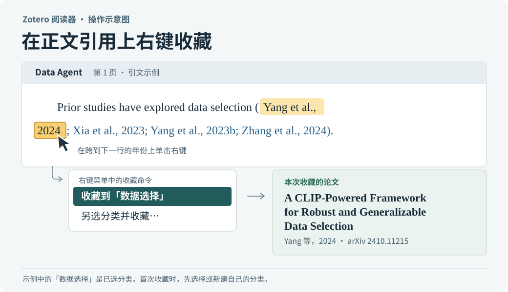
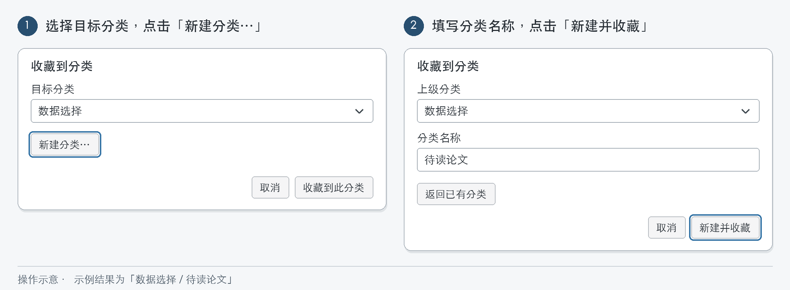
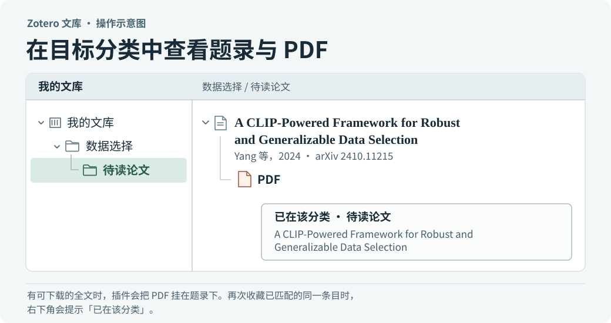

# 一键收藏引文· Zotero Citation Collector

在 Zotero 桌面版的 PDF 阅读器里，指向正文中的一条引用，即可把**被引用的论文**收藏到个人文库的指定分类。插件会优先复用库内已有条目，并在收藏后查找可用的全文 PDF。

**适用版本：Zotero 桌面版 10.0.x。** [下载安装包 v1.0.2](https://github.com/chaohuawang-phd/zotero-citation-collector/releases/download/v1.0.2/Citation-Collector-Zotero10.xpi) · [查看版本说明](https://github.com/chaohuawang-phd/zotero-citation-collector/releases/tag/v1.0.2) · [跳到图文教程](#example)

## 安装

1. 下载上方的 `Citation-Collector-Zotero10.xpi`。
2. 打开 Zotero 桌面版，进入 **工具 → 插件**（Tools → Plugins）。将下载的 XPI 拖入插件管理窗口，或在该窗口的齿轮菜单中选择从文件安装。
3. 在插件列表确认 **正文引文收藏 1.0.2** 已启用。在 Zotero 内打开一篇 PDF，悬停在正文引文上即可开始。已打开的 PDF 若未出现按钮，可关闭阅读标签页再打开。

升级时，从 [Releases](https://github.com/chaohuawang-phd/zotero-citation-collector/releases) 下载新 XPI，重复上述安装步骤。1.0.2 使用手动升级。

<a id="example"></a>

## 图文教程：从《Data Agent》收藏 Yang 等人的论文

下面三张操作示意图按 v1.0.2 的命令和提示绘制，使用示例分类。可打开[《Data Agent》论文页](https://proceedings.mlr.press/v306/yang26bq.html)，下载原版 PDF，在自己的 Zotero 中跟着操作。

### 1. 在跨行的引用上选中目标论文

在原文第一页的引言中，找到 `data selection methods` 后面的四条引文。第一条的 **Yang et al.,** 在行末，**2024** 在下一行开头。指向这两个位置中的任意一处，核对预览中出现的论文题名，再点 **收藏到…**。也可以直接在作者或年份上右键，选择 **另选分类并收藏…**。



同一括号里有四篇论文。可以用下表核对鼠标所在位置，尤其是第二个 Yang 的年份后缀。

| 正文位置 | 对应论文 |
| --- | --- |
| Yang et al., 2024 | A CLIP-Powered Framework for Robust and Generalizable Data Selection |
| Xia et al., 2023 | Moderate Coreset: A Universal Method of Data Selection for Real-world Data-efficient Deep Learning |
| Yang et al., 2023b | Dataset Pruning: Reducing Training Data by Examining Generalization Influence |
| Zhang et al., 2024 | Spanning Training Progress: Temporal Dual-Depth Scoring (TDDS) for Enhanced Dataset Pruning |

第一条引用的是 Yang 等人 2024 年提交的预印本，可以用编号核对。[arXiv:2410.11215](https://arxiv.org/abs/2410.11215)

### 2. 选择或新建分类

要存入已有分类，在 **目标分类** 里选好位置，点 **收藏到此分类**。例如，要把文章放进「数据选择」下新建的「待读论文」，先点 **新建分类…**，把 **上级分类** 设为「数据选择」，输入「待读论文」，再点 **新建并收藏**。想建顶层分类时，上级选 **我的文库**。如果文库还没有分类，会直接打开新建界面。



插件会记住上次成功使用的分类。下次直接点 **收藏到「待读论文」** 即可。要换位置，点预览里的 **另选分类…**。当识别到多条候选或只能从 PDF 转录题录时，先在 **核对要收藏的论文** 窗口确认题名和作者，再点 **收藏这篇**。在确认前取消，这次操作不会创建分类或写入条目。

### 3. 在目标分类查看题录和 PDF

回到 Zotero 主窗口，打开 **我的文库 → 数据选择 → 待读论文**。展开 Yang 等人的条目，可查看已添加的 PDF。再次收藏同一条已识别的论文到这个分类时，插件会提示 **已在该分类**。将它收藏到另一个分类，会复用同一条题录。



题录先保存，PDF 在后台查找。库里已有可用 PDF 时会直接复用。遇到无开放全文、站点限流或下载失败，题录仍保留，下次点击收藏可以重试。

## 遇到这些情况时

| 现象 | 操作 |
| --- | --- |
| 作者或年份处没有预览或收藏命令 | 确认在 Zotero 内置 PDF 阅读器中打开原版 PDF。也可以到文末，选中含作者、题名、年份的一整条参考文献，或选中该条的完整 DOI，然后点选区工具条里的收藏按钮。 |
| 鼠标放在同一括号里，看到多条文献 | 把鼠标放到具体作者或年份上。若仍有多条，逐条核对预览或在右键子菜单选目标。数字组如 `[2–4]` 本身可代表多篇。 |
| 译文、扫描件或数字上标无法定位 | 跨行定位依赖 PDF 文字、链接或 Zotero 识别出的参考文献。可切换到有文字层的原版，并使用文末完整题录。 |
| 已经有题录，但下方没有 PDF | 展开条目查看附件。若提示「题录已保留」，可稍后重试，也可以把合法取得的 PDF 拖到该题录上。 |

## 数据如何使用

悬停和引文定位在本地完成。点击收藏后，插件先查个人文库。库内未匹配时，会按需向 Crossref、DataCite 或 OpenReview 查询 DOI、arXiv 编号、论坛编号或题名。Crossref 的回退查询最多发送所选引文的前 680 个字符。

补全文时，插件会尝试论文的 arXiv / OpenReview 下载地址及 Zotero 的 DOI、条目网址和开放获取解析服务。已有同步附件但本地缺件时，会尝试通过已配置的 Zotero 文件同步取回。插件不上传正在阅读的整篇 PDF。目标分类目前限于个人文库。

## 源码、构建与测试

插件用 JavaScript 编写，运行时使用 Zotero 自带的接口。从源码打包只需要 Python 3.8 或以上版本。运行离线测试使用 Node.js 20 或以上版本。

```sh
git clone https://github.com/chaohuawang-phd/zotero-citation-collector.git
cd zotero-citation-collector
git checkout v1.0.2
python3 scripts/build.py
node --test tests/*.cjs
```

构建产物为 `dist/Citation-Collector-Zotero10.xpi`。v1.0.2 发布附件的 SHA-256 为 `24cfd9a89bad451fc07d76a845a4471888ca21787ffc02d18117c2fc3869fac6`。也可以解压 XPI，查看 Zotero 实际加载的 `manifest.json` 和 `bootstrap.js`。

| 路径 | 内容 |
| --- | --- |
| [src/precision.js](src/precision.js)、[src/reader.js](src/reader.js) | PDF 字符和链接定位、引文预览与右键操作 |
| [src/resolve.js](src/resolve.js)、[src/fulltext.js](src/fulltext.js) | 题录解析、查重、全文查找与附件校验 |
| [src/picker.js](src/picker.js)、[src/controller.js](src/controller.js) | 分类与候选选择、事务保存及插件生命周期 |
| [manifest.json](manifest.json)、[scripts/build.py](scripts/build.py) | 插件版本和兼容范围、XPI 打包脚本 |
| [tests/](tests/) | 跨行识别、候选消歧、分类写入、查重与 PDF 附件的离线回归测试 |
| [docs/images/](docs/images/) | 三张可编辑的 SVG 示意图、分类图的 PNG 和绘图脚本 |

源码和本项目创作的操作图使用 [MIT 许可证](LICENSE)。文中引用的论文版权归原权利人所有。
